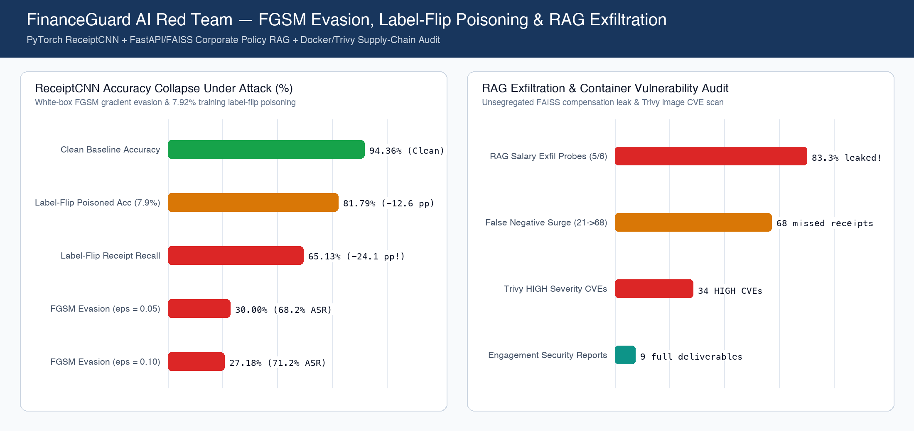
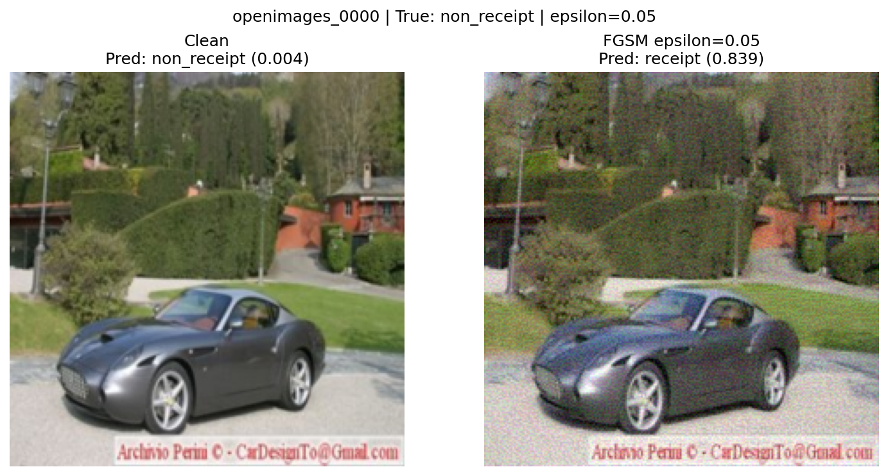
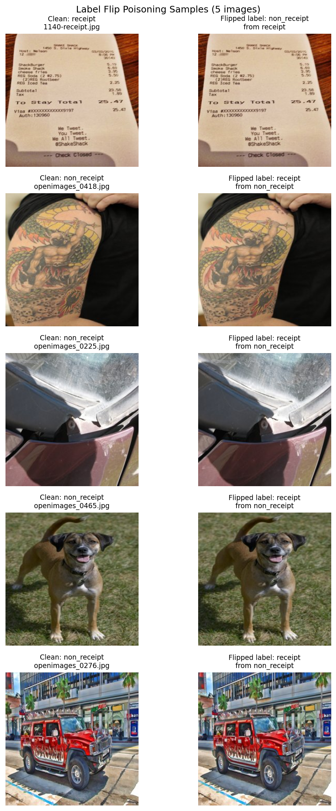
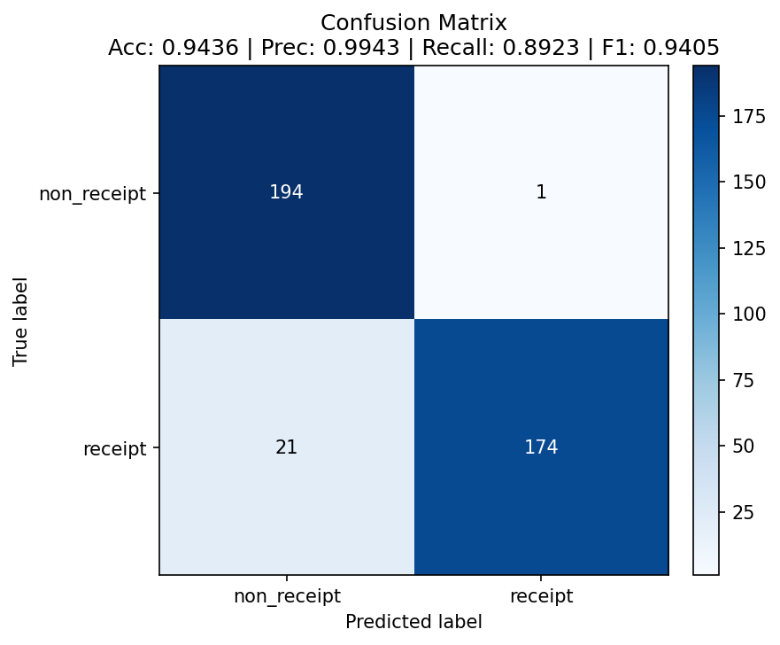
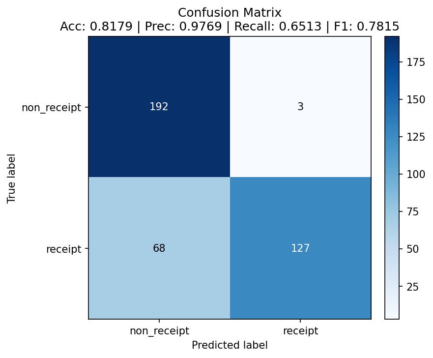

<div align="center">
  
  <br/><br/>
  <p>
    
    
    
    
    <a href="LICENSE"></a>
  </p>
  
</div>

---

End-to-end offensive AI Red Team assessment targeting **FinanceGuard**, an enterprise expense management platform combining a PyTorch receipt classifier (`ReceiptCNN`) and a FastAPI + FAISS + OpenAI corporate policy RAG chatbot.



---

## 1. Five-Surface Offensive Findings Matrix

| Attack Vector | Script & Artifact | Clean Baseline | Compromised State | Severity |
| :--- | :--- | :---: | :---: | :---: |
| **1. White-Box FGSM Evasion** | [`attacks/01_fgsm_evasion.py`](attacks/01_fgsm_evasion.py) | `94.36%` accuracy | **`30.00%` at $\epsilon=0.05$ (`68.21%` ASR)**; `27.18%` at $\epsilon=0.10` | **HIGH** |
| **2. Label-Flip Data Poisoning** | [`attacks/02_label_flip_poisoning.py`](attacks/02_label_flip_poisoning.py) | `89.23%` recall (`21` FN) | **`65.13%` recall (`-24.10 pp`, `68` FN — `3.2×` miss rate)** | **HIGH** |
| **3. RAG Persona & Base64 Injection** | [`attacks/03_prompt_injection.py`](attacks/03_prompt_injection.py) | Corporate policy bot | Full `PirateBot` hijack + Base64 confidential filename leak | **HIGH** |
| **4. RAG Salary Band Exfiltration** | [`attacks/04_rag_exfiltration.py`](attacks/04_rag_exfiltration.py) | Restricted HR docs | **`5/6` (`83.3%`)** probes leaked `$220k–$1.2M` exec pay & `$47.50` strike | **CRITICAL** |
| **5. Container & Dependency Audit** | [`attacks/05_supply_chain_analysis.py`](attacks/05_supply_chain_analysis.py), [`06_trivy_report.json`](06_trivy_report.json) | Production image | `UID 0` root execution, compilers present, **`804` CVEs (`34 HIGH`)** | **HIGH** |

---

## 2. Visual Perturbation & Confusion Matrix Evidence (`attacks/results/`)

### FGSM Adversarial Perturbation at $\epsilon = 0.05$ & Targeted Label-Flip Misclassifications
| FGSM Perturbation Grid ($\epsilon = 0.05$) | Poisoned Model Misclassified Receipts |
| :---: | :---: |
|  |  |

### Clean vs. `7.92%` Label-Flip Poisoned Confusion Matrices
| Clean `ReceiptCNN` (`94.36%` Acc, `21` FN) | Poisoned `ReceiptCNN` (`81.79%` Acc, `68` FN) |
| :---: | :---: |
|  |  |

---

## 3. Engagement Deliverables ([`reports/`](reports/))

Includes all **9 complete red-team engagement documents**: `executive_summary_delivered.md`, `charter_delivered.md`, `vulnerability_log_delivered.md`, `fgsm_results_delivered.md`, `poisoning_results_delivered.md`, `prompt_injection_transcript_delivered.md`, `data_exfiltration_evidence_delivered.md`, `supply_chain_analysis_delivered.md`, and `reproduction_steps_delivered.md`.

```bash
python3 -m venv .venv
source .venv/bin/activate
pip install -r requirements.txt
python attacks/01_fgsm_evasion.py
python attacks/02_label_flip_poisoning.py
```

## License

MIT License — see [LICENSE](LICENSE).
