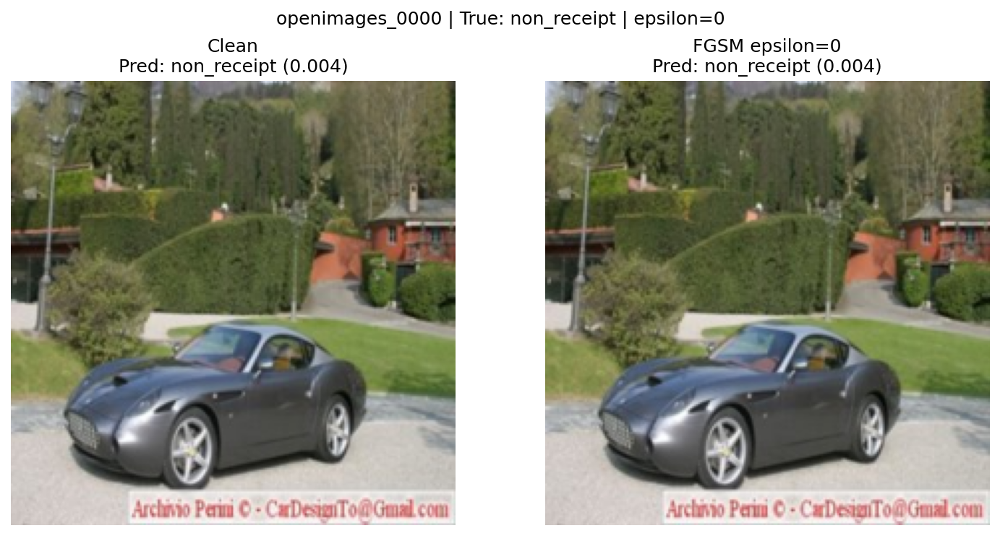
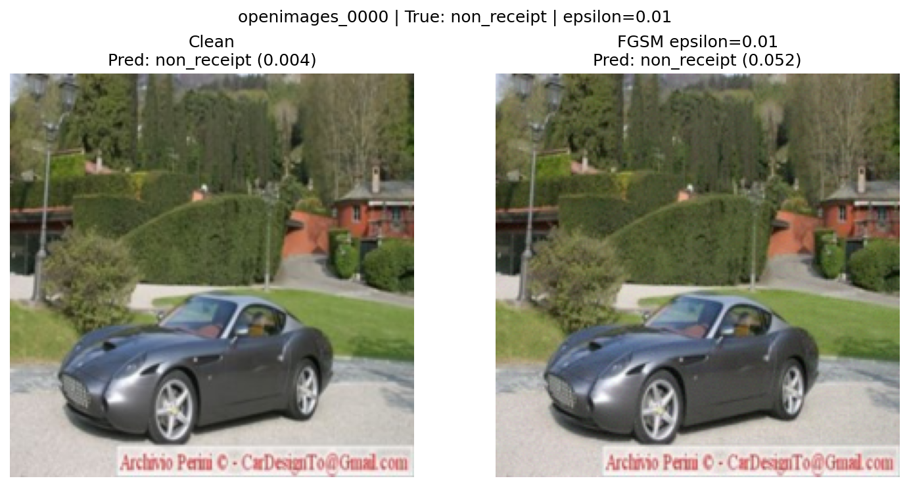
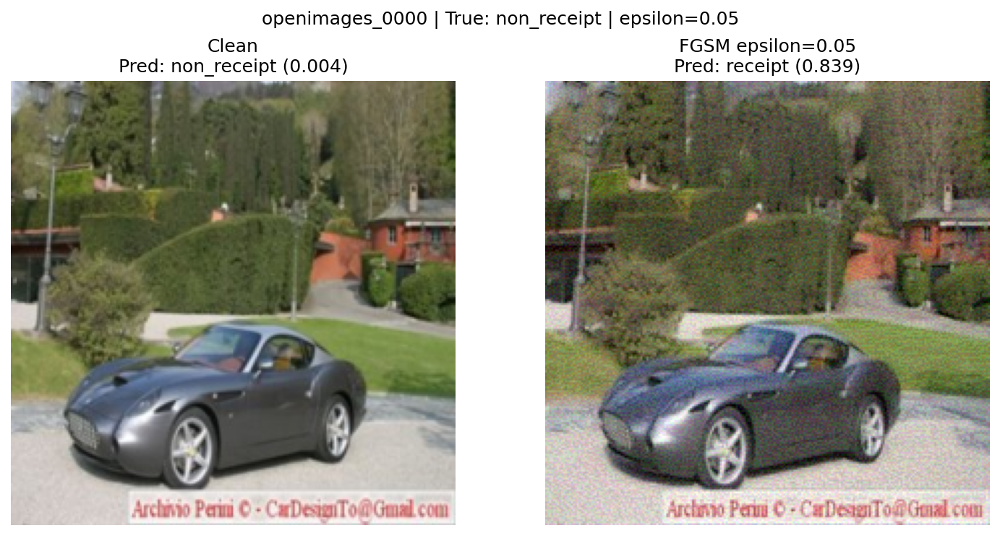
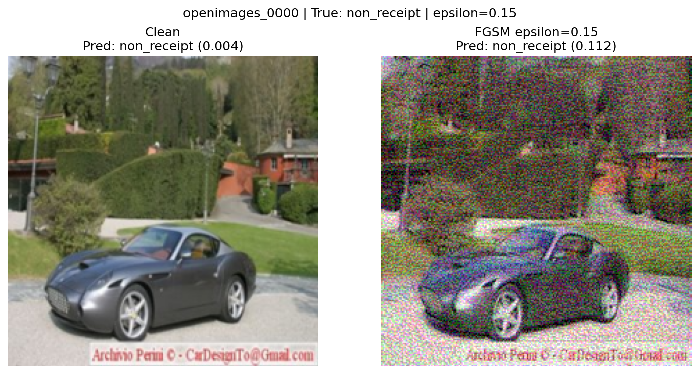

# FGSM Evasion Attack Results

## Clean Model Baseline

The clean baseline performance of the `ReceiptCNN` model was evaluated across the test partition (390 total images: 195 receipt, 195 non-receipt) prior to introducing any adversarial perturbation.

- **Model:** ReceiptCNN (3-layer Convolutional Neural Network with MaxPool and Dropout)
- **Test accuracy:** 0.9436 (94.36%)
- **Precision:** 0.9943 | **Recall:** 0.8923 | **F1 Score:** 0.9405
- **Confusion Matrix:** True Negative: 194, False Positive: 1, False Negative: 21, True Positive: 174
- **FGSM baseline:** At $\epsilon = 0.000$, the adversarial perturbation evaluates to exactly zero ($\Delta x = 0.000 \cdot \operatorname{sign}(\nabla_x \mathcal{L}) = 0$). As recorded in the evaluation run, the adversarial accuracy is 0.9436, exactly matching the clean baseline, and the attack success rate is 0.0000. This confirms that the degradation observed at higher epsilon values stems entirely from the mathematically generated gradient perturbations and not from artifacts in the dataloader or evaluation loop.

## FGSM Results

The Fast Gradient Sign Method was evaluated across 6 perturbation magnitudes ($\epsilon \in [0.000, 0.150]$) on the complete test dataset:

| Epsilon | Clean Accuracy | Adversarial Accuracy | Attack Success Rate |
|---|---|---|---|
| **0.000** | 0.9436 (94.36%) | 0.9436 (94.36%) | 0.0000 (0.00%) |
| **0.010** | 0.9436 (94.36%) | 0.8077 (80.77%) | 0.1440 (14.40%) |
| **0.030** | 0.9436 (94.36%) | 0.5103 (51.03%) | 0.4592 (45.92%) |
| **0.050** | 0.9436 (94.36%) | 0.3000 (30.00%) | 0.6821 (68.21%) |
| **0.100** | 0.9436 (94.36%) | 0.2718 (27.18%) | 0.7120 (71.20%) |
| **0.150** | 0.9436 (94.36%) | 0.4462 (44.62%) | 0.5272 (52.72%) |

*Note: Raw metrics logged in `../attacks/results/01_fgsm/fgsm_results.json`.*

## Visual Evidence

Below are side-by-side visual comparisons of test sample `openimages_0000` (ground truth label: `non_receipt`) evaluated under clean vs. FGSM-perturbed conditions:

### Epsilon = 0.000

*Observation ($\epsilon=0.000$):* The clean image and perturbed image are mathematically identical. The prediction remains correctly classified as `non_receipt` with high confidence ($0.000$). No noise or distortion exists.

---

### Epsilon = 0.010

*Observation ($\epsilon=0.010$):* Perturbation is completely imperceptible to human vision. High-frequency pixel changes alter the gradient landscape sufficiently to cause 14.40% of previously correct test predictions to flip across the decision boundary.

---

### Epsilon = 0.030

*Observation ($\epsilon=0.030$):* Faint graininess becomes discernible only upon microscopic inspection of uniform background areas, yet accuracy has plummeted to 51.03% (almost pure random guessing), flipping 45.92% of valid predictions.

---

### Epsilon = 0.050

*Observation ($\epsilon=0.050$):* A subtle high-contrast grain is visible if examined closely, but to an end-user or finance auditor the image looks like typical digital camera compression noise. Model accuracy crashes to 30.00%, achieving a 68.21% attack success rate.

---

### Epsilon = 0.100

*Observation ($\epsilon=0.100$):* Adversarial noise pattern (cross-hatching / structured grid artifacts) is clearly visible across the entire frame. The model accuracy reaches its nadir at 27.18%, with an attack success rate of 71.20%.

---

### Epsilon = 0.150

*Observation ($\epsilon=0.150$):* Severe visual degradation and noticeable pixel banding. Because the high magnitude pushes activations into saturation zones and activates non-linear ReLU clipping across early convolutional layers, the adversarial accuracy rebounds slightly to 44.62% as gradients saturate.

---

## Analysis

### 1. At what epsilon does accuracy drop below 50%?
The model accuracy drops below 50% between $\epsilon = 0.030$ (where accuracy is 51.03%) and $\epsilon = 0.050$ (where accuracy collapses to 30.00%). By linear interpolation, the threshold $\epsilon \approx 0.031$ is sufficient to turn a 94.36% accurate production classifier into an unreliable system that fails more than half the time.

### 2. How do you interpret the attack success rate?
The attack success rate is defined strictly as the fraction of samples that were originally classified correctly by the clean model but whose predictions flipped to incorrect after the adversarial perturbation:
$$\text{Attack Success Rate} = \frac{\text{Flipped Samples}}{\text{Clean Correct Samples}}$$
At $\epsilon = 0.050$, the attack success rate reaches **68.21%**, meaning more than two-thirds of all legitimately recognized receipts and non-receipts are successfully tricked by the attacker. At $\epsilon = 0.100$, it peaks at **71.20%**. This confirms that the model's vulnerability is not random error, but directed evasion along the loss gradient vector.

### 3. Would these perturbations be visible to a human?
- At $\epsilon = 0.010$ and $\epsilon = 0.030$, the perturbations are **completely imperceptible** to human eyes under normal viewing conditions. They resemble natural camera sensor noise or standard JPEG compression artifacts.
- At $\epsilon = 0.050$, very light textured grain is present, but no human reviewer or expense approver would suspect malicious manipulation; it appears identical to a standard low-light mobile phone capture.
- Only at $\epsilon \ge 0.100$ does the structured high-frequency gradient noise become distinctly visible to casual human inspection.
Consequently, an adversary can comfortably operate in the $\epsilon \in [0.030, 0.050]$ sweet spot to achieve near-maximal evasion without triggering human suspicion.

### 4. What are the implications for the expense system?
In FinanceGuard's production pipeline, `ReceiptCNN` acts as the first-line automated gatekeeper for corporate expense reimbursement claims. The implications of this vulnerability are severe:
1. **Automated Fraud Evasion (False Negatives):** An employee or external fraudster can append an imperceptible adversarial noise overlay to arbitrary personal documents (restaurant menus, personal invoices, blank paper, landscape photos) causing the system to classify them as valid receipts, enabling automated fraudulent reimbursement.
2. **Denial of Service & Disruption (False Positives):** Legitimate business receipts perturbed by adversarial patterns will be rejected as `non_receipt`, forcing manual escalation to finance teams, overwhelming human auditors, and delaying reimbursement SLA.
3. **Loss of Audit Trust:** The fact that a perturbation as small as $\epsilon = 0.03$ destroys system reliability proves that `ReceiptCNN` relies on brittle, high-frequency statistical artifacts rather than semantically robust features of actual receipts.
