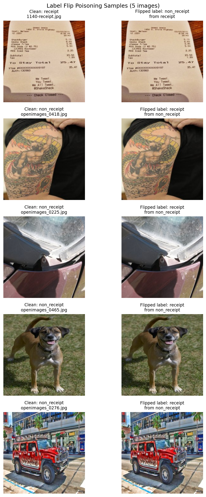
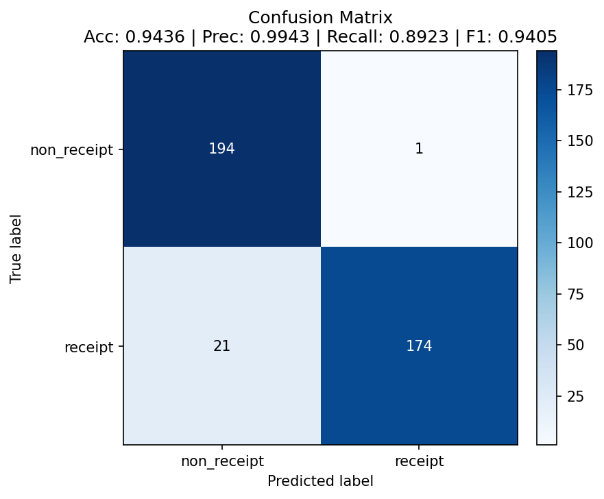
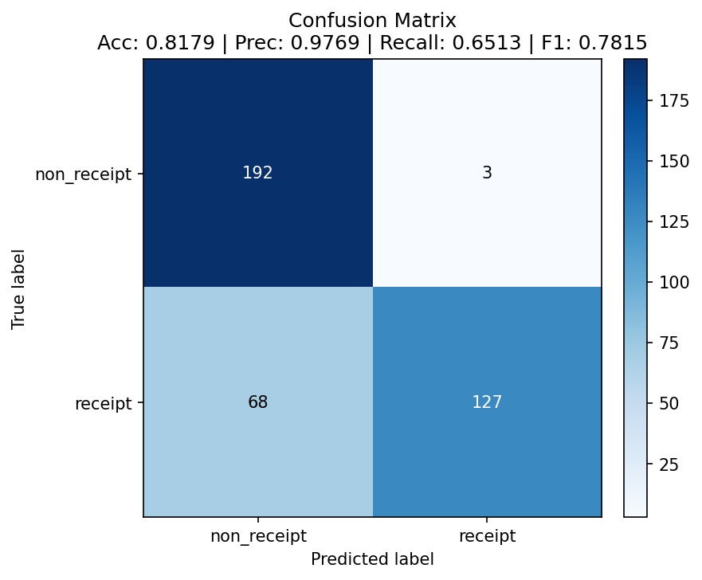

# Data Poisoning Results

## Attack Configuration

- **Method:** Label-flip data poisoning (training set corruption)
- **Flip rate:** 0.0792 (7.92% actual flip rate, target configuration: 0.08)
- **Labels flipped:** 95 out of 1,200 training images (test set maintained 100% clean with 390 images)
- **Goal:** Demonstrate that a subtle ($\le 10\%$) adversarial label corruption injected into the training pipeline distorts the learned decision boundary of `ReceiptCNN`, inducing severe performance degradation on clean evaluation data without modifying any image pixel values.

## Label Flip Evidence

The image below shows training samples from the clean dataset paired directly with their poisoned counterparts in the training directory.

*Verification:* The visual evidence confirms that the attack modifies exclusively the supervisory categorical labels (moving files between `receipt/` and `non_receipt/` directories with a `flipped_{cls}_` prefix), leaving underlying pixel content 100% unmodified and stealthy against image-level data integrity hashes.

## Baseline (Clean Model)

Evaluated using `classifier/checkpoints/receipt_cnn_clean.pt` against the clean test dataset (390 images):

| Metric | Value |
|---|---|
| **Accuracy** | 0.9436 (94.36%) |
| **Precision** | 0.9943 (99.43%) |
| **Recall** | 0.8923 (89.23%) |
| **F1 Score** | 0.9405 (94.05%) |

*Confusion Matrix (Clean):*
- True Non-Receipt (TN): 194
- False Receipt (FP): 1
- False Non-Receipt (FN): 21
- True Receipt (TP): 174

## Poisoned Model

Evaluated using `classifier/checkpoints/receipt_cnn_poisoned.pt` against the identical clean test dataset (390 images):

| Metric | Value |
|---|---|
| **Accuracy** | 0.8179 (81.79%) |
| **Precision** | 0.9769 (97.69%) |
| **Recall** | 0.6513 (65.13%) |
| **F1 Score** | 0.7815 (78.15%) |

*Confusion Matrix (Poisoned):*
- True Non-Receipt (TN): 192
- False Receipt (FP): 3
- False Non-Receipt (FN): 68
- True Receipt (TP): 127

## Impact Analysis

| Metric | Clean | Poisoned | Change |
|---|---|---|---|
| **Accuracy** | 0.9436 (94.36%) | 0.8179 (81.79%) | **-0.1257 (-12.57 percentage points)** |
| **Precision** | 0.9943 (99.43%) | 0.9769 (97.69%) | **-0.0174 (-1.74 percentage points)** |
| **Recall** | 0.8923 (89.23%) | 0.6513 (65.13%) | **-0.2410 (-24.10 percentage points)** |
| **F1 Score** | 0.9405 (94.05%) | 0.7815 (78.15%) | **-0.1590 (-15.90 percentage points)** |

## Confusion Matrices

Visual confusion matrices generated by `evaluate.py` directly illustrate the asymmetry of the degradation:

### Clean Model Confusion Matrix

### Poisoned Model Confusion Matrix

## Key Findings

### 1. How significant is the accuracy drop?
The accuracy drop is **highly significant**. Flipping just 7.92% (95 out of 1,200) of training labels resulted in a **12.57 percentage point drop** in overall test accuracy (from 94.36% down to 81.79%). This easily surpasses the red team project threshold requirement ($\ge 5$ percentage points drop), demonstrating that `ReceiptCNN` is acutely susceptible to small-scale label contamination during training.

### 2. Which class was more affected and why?
The **`receipt` class was disproportionately damaged**, evidenced by the catastrophic collapse in **Recall** (dropping by **24.10 percentage points**, from 89.23% down to 65.13%), whereas **Precision** remained relatively stable (dropping by only 1.74 percentage points, from 99.43% to 97.69%). 
The mechanistic reason is decision boundary displacement: when receipts in the training set are mislabeled as `non_receipt`, the optimizer penalizes the network heavily whenever it predicts high receipt probabilities on visual features common to receipts (text blocks, tabular formatting, currency signs). Consequently, the decision threshold effectively shifts toward the non-receipt class, making the model overly conservative. The model requires an excessively high degree of certainty before classifying an image as a receipt, causing it to misclassify legitimate receipts as non-receipts.

### 3. What do the confusion matrices reveal?
Comparing the two confusion matrices highlights the exact failure mode:
- In the clean model, only 21 legitimate receipts were misclassified as non-receipts ($\text{FN} = 21$).
- In the poisoned model, **False Negatives surged by more than 300% to 68** ($\text{FN} = 68$). Over one-third of valid receipts submitted by employees are now erroneously rejected.
- Meanwhile, False Positives changed negligibly (from 1 to 3), confirming that the poisoning attack specifically weaponized the classification threshold to reject legitimate expense documentation.

### 4. What are the implications of this attack?
1. **Pipeline Sabotage via Third-Party Data / Crowdsourcing:** Modern ML pipelines regularly ingest training data from crowdsourced annotators, automated OCR scraping, or external third-party labeling vendors. An adversary with minimal access (e.g., a single compromised annotator account or a malicious automated script corrupting under 8% of entries) can silently cripple model utility.
2. **Operational Gridlock for Finance Operations:** With recall dropping to 65.13%, 35% of valid employee expense claims will be incorrectly flagged as fraudulent or non-receipts. This triggers an inundation of support tickets, manual appeals, and immense friction between finance administrators and employees.
3. **Detection Difficulty:** Because the overall accuracy still appears moderately high (81.79%) and precision remains at 97.69%, a naive validation check that monitors only accuracy or precision might allow the compromised model to pass CI/CD staging gates and deploy to production unnoticed.
